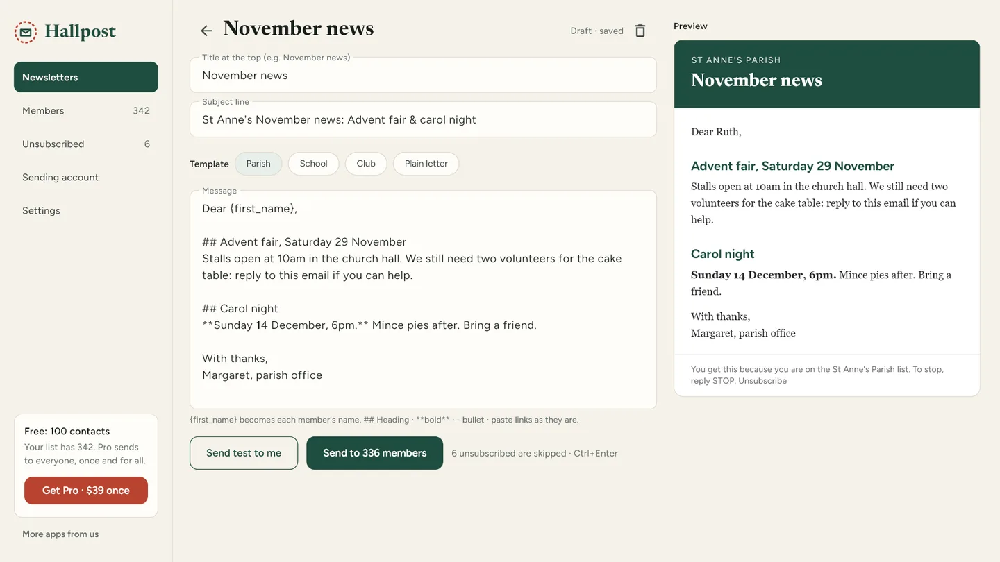
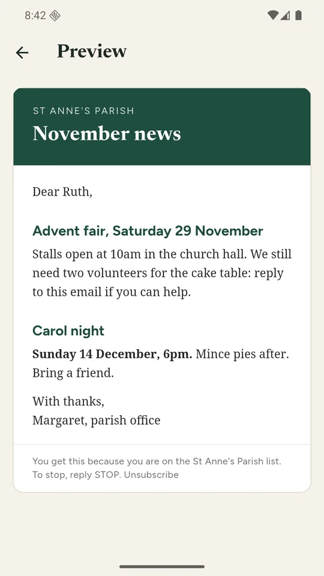

# Hallpost: Email Newsletter

Send your church, club or PTA newsletter from your group's own Gmail, Zoho, Yahoo or iCloud account. Hallpost is a buy-once email newsletter app for Windows and Android: import your members from a CSV, pick a template, and it sends at a safe pace under your mailbox's daily limit.

**[Get it from Microsoft](https://apps.microsoft.com/detail/9P26MH76WMBZ)** · **[Get it on Google Play](https://play.google.com/store/apps/details?id=com.hallpostapp.hallpost)** · [Website](https://hallpost.pages.dev/) · [Watch the Windows demo](https://youtu.be/0GxnR_9ktpU) · [Android teaser](https://youtube.com/shorts/HDfYshY6d58)

| Windows | Android |
|---|---|
|  |  |

## What it does

- **Sends from your own mailbox.** Gmail, Google Workspace, Zoho Mail, Yahoo Mail, iCloud Mail or any SMTP server with an app password. Replies come straight back to you.
- **Paced sending.** One email every few seconds, under a daily limit you set (Gmail allows about 500 a day). At the limit it stops and carries on tomorrow from the same member. Pause and resume any time.
- **Member import.** CSV from Google Contacts, Excel, Outlook or another newsletter service. Every row it can't use is listed with the reason.
- **Templates and preview.** Parish, School, Club and Plain letter, with a live preview. `{first_name}` personalises each email. Send a test to yourself first.
- **Unsubscribe list.** Every newsletter ends with "reply STOP"; paste the replies in and those people are never mailed again.
- **Domain check.** For your own domain, Hallpost checks SPF and DMARC and says in plain words what to fix so mail reaches the inbox.

## Privacy

Members, newsletters and the unsubscribe list stay on your device. Email goes only to your own mail server. There is no account, no server of ours, no tracking pixels and no analytics. Full policy: <https://hallpost.pages.dev/privacy/>

## Price

- **Windows:** free for up to 100 contacts per newsletter. **Hallpost Pro is $39 once** (2 PCs) or **$59 for 5 PCs**, no monthly bill.
- **Android:** free, supported by ads. A short video sends a newsletter to your whole list.

## Support

anithabheesetty@gmail.com

This repository is the product page for Hallpost. The app's source is not published here.
